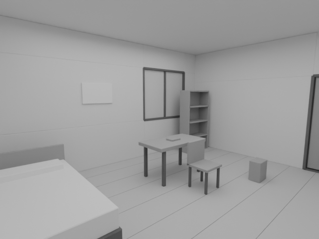
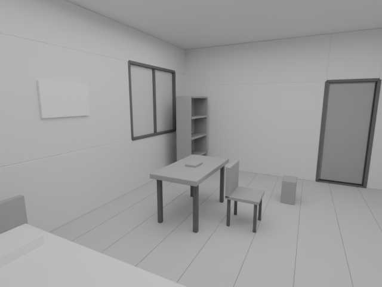
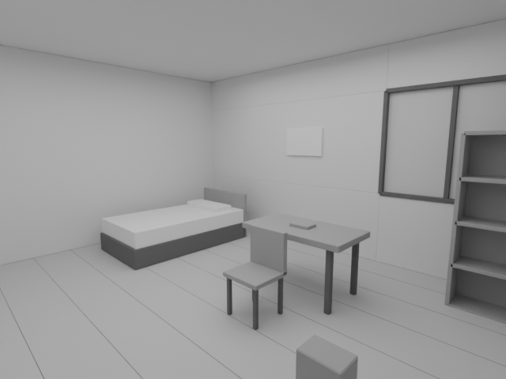
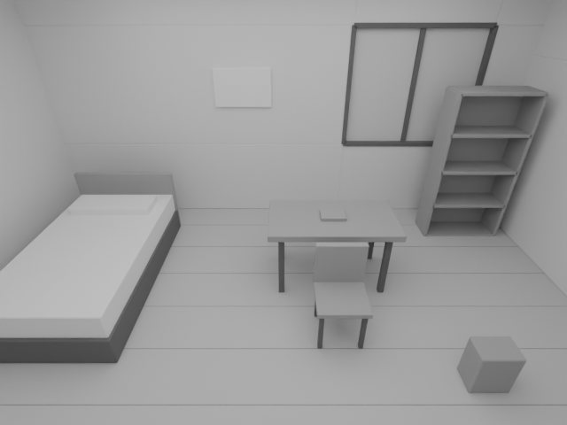
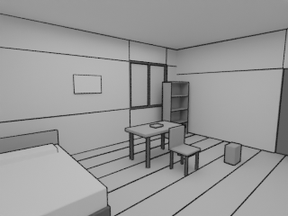

# 公開用の実出力サンプル

2026-10-12、`tests/fixtures.py`の手定義一室を`create_demo.py`から生成したBlender直接レンダーです。元画像は同じ手定義3Dからの出力です。私的原稿・写真・外部モデル・生成AIは使っていません。

4方向は同じ15オブジェクトの保存配置を使用します。`source/left/right/high.png`は640×480。`mcp-balanced.png`は同じ保存3Dを既存MCPから単発撮影し、線・トーン設定を適用した320×240の出力です。ファイルハッシュは`provenance.json`にあります。

| 基準 | 左側 |
| --- | --- |
|  |  |
|  |  |

構造・カメラ・保存の動作例です。画像からの自動AI復元、複雑な布の完成品質、外部編集を済ませた漫画の作例として宣伝しません。新規利用者は導入手順に従って自分の端末で同じサンプルを作れます。シーン自体は配布ZIPに含めず、軽いPNGだけを載せています。
